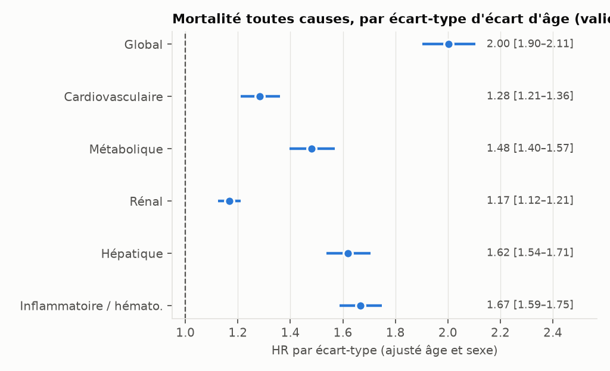
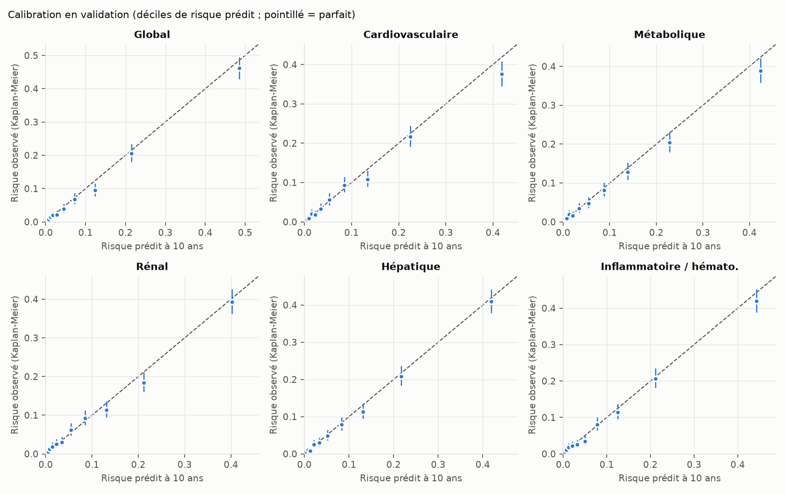
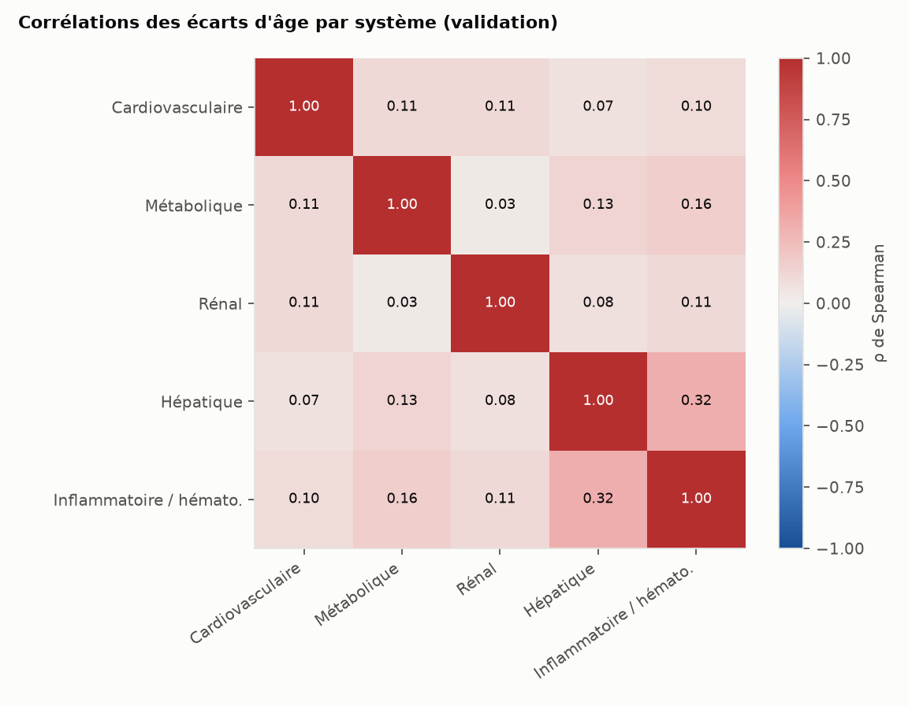
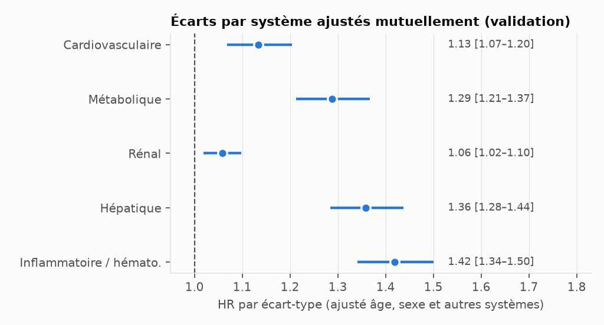

# Résultats de validation — panel `checkup_standard`

Rapport généré automatiquement par `python -m aging_clock validate --panel checkup_standard`.
Toutes les figures et tables sont dans ce dossier (CSV = vue tableau des figures).

- Développement : cycles NHANES 1999, 2001, 2003, 2005 ; validation temporelle : 2007, 2009.
- Mortalité : Linked Mortality Files 2019 (NCHS). Horizon de l'âge biologique : 10 ans.
- Pénalisation ridge des marqueurs choisie par validation croisée sur le développement : 0.0.
- IC à 95 % par bootstrap (1000 répliques ; 300 pour les sensibilités) ; graine 42.
- Empreinte SHA-256 du panel : `386534955bfe31e2…`.

## Population

| etape | n |
|---|---|
| participants NHANES | 62160 |
| age 20-79 ans | 29725 |
| eligibles au chainage mortalite, suivi > 0 | 28396 |
| hors femmes enceintes | 27175 |
| cas complets sur le panel | 23296 |

| echantillon | n | deces | suivi_median_ans | age_moyen | pct_femmes | cycles |
|---|---|---|---|---|---|---|
| developpement | 13986 | 2842 | 16.1 | 47.4 | 48.7 | 1999, 2001, 2003, 2005 |
| validation | 9310 | 997 | 10.7 | 48.0 | 50.2 | 2007, 2009 |

## Discrimination et association (validation)

C de référence (Cox âge + sexe) : **0.807 [0.794; 0.819]**.

| Score | C (IC95) | Gain de C vs âge + sexe (IC95) | HR par ET d'écart (IC95) | ET de l'écart (ans) |
|---|---|---|---|---|
| Global | 0.852 [0.841; 0.863] | 0.045 [0.039; 0.052] | 2.00 [1.90; 2.11] | 7.2 |
| Cardiovasculaire | 0.814 [0.801; 0.825] | 0.007 [0.004; 0.009] | 1.28 [1.21; 1.36] | 2.8 |
| Métabolique | 0.820 [0.807; 0.832] | 0.013 [0.009; 0.017] | 1.48 [1.40; 1.57] | 4.0 |
| Rénal | 0.811 [0.797; 0.823] | 0.004 [0.001; 0.006] | 1.17 [1.12; 1.21] | 2.0 |
| Hépatique | 0.832 [0.819; 0.844] | 0.025 [0.021; 0.029] | 1.62 [1.54; 1.71] | 4.4 |
| Inflammatoire / hémato. | 0.833 [0.821; 0.845] | 0.026 [0.021; 0.032] | 1.67 [1.59; 1.75] | 5.2 |

HR par écart-type de l'écart d'âge, ajusté sur l'âge et le sexe, Cox ajusté dans l'échantillon de validation.

## Calibration à 10 ans (validation)

| Score | Risque prédit moyen | Risque observé (KM) | Observé / prédit | Pente (IC95) | Écart absolu moyen (déciles) |
|---|---|---|---|---|---|
| Global | 0.101 | 0.094 | 0.93 | 1.01 [0.96; 1.06] | 0.008 |
| Cardiovasculaire | 0.100 | 0.094 | 0.93 | 0.96 [0.91; 1.02] | 0.010 |
| Métabolique | 0.101 | 0.094 | 0.93 | 0.99 [0.93; 1.05] | 0.010 |
| Rénal | 0.097 | 0.094 | 0.97 | 0.96 [0.91; 1.02] | 0.008 |
| Hépatique | 0.098 | 0.094 | 0.95 | 1.03 [0.97; 1.08] | 0.006 |
| Inflammatoire / hémato. | 0.099 | 0.094 | 0.95 | 0.99 [0.94; 1.05] | 0.007 |

Pente = coefficient du log(-log(1 - risque prédit)) dans un Cox de validation (1 = idéal).

## Indépendance des écarts par système (validation)

Corrélations de Spearman entre écarts d'âge par système :

|  | Cardiovasculaire | Métabolique | Rénal | Hépatique | Inflammatoire / hémato. |
|---|---|---|---|---|---|
| Cardiovasculaire | 1.00 | 0.11 | 0.11 | 0.07 | 0.10 |
| Métabolique | 0.11 | 1.00 | 0.03 | 0.13 | 0.16 |
| Rénal | 0.11 | 0.03 | 1.00 | 0.08 | 0.11 |
| Hépatique | 0.07 | 0.13 | 0.08 | 1.00 | 0.32 |
| Inflammatoire / hémato. | 0.10 | 0.16 | 0.11 | 0.32 | 1.00 |

Cox avec tous les écarts par système ensemble (ajusté âge et sexe) :

| Système | HR par ET, ajusté mutuellement (IC95) | p |
|---|---|---|
| Cardiovasculaire | 1.13 [1.07; 1.20] | 3.9e-05 |
| Métabolique | 1.29 [1.21; 1.37] | 9.9e-17 |
| Rénal | 1.06 [1.02; 1.10] | 3.2e-03 |
| Hépatique | 1.36 [1.28; 1.44] | 8.0e-27 |
| Inflammatoire / hémato. | 1.42 [1.34; 1.50] | 1.4e-34 |

## Sensibilités

« figé » = modèle principal appliqué au sous-échantillon de validation ;
« ré-entraîné » = modèle ré-entraîné sur le développement filtré de la même façon.
Pour les causes spécifiques, les décès d'autres causes sont censurés.

| scenario | modele | Score | n | deces | C | C_ic95 | dC | dC_ic95 | HR_par_ET | HR_ic95 |
|---|---|---|---|---|---|---|---|---|---|---|
| principal | fige | Global | 9310 | 997 | 0.852 | [0.843; 0.863] | 0.045 | [0.039; 0.052] | 2.002 | [1.90; 2.11] |
| principal | fige | Cardiovasculaire | 9310 | 997 | 0.814 | [0.803; 0.825] | 0.007 | [0.004; 0.009] | 1.284 | [1.21; 1.36] |
| principal | fige | Métabolique | 9310 | 997 | 0.820 | [0.810; 0.833] | 0.013 | [0.009; 0.017] | 1.480 | [1.40; 1.57] |
| principal | fige | Rénal | 9310 | 997 | 0.811 | [0.799; 0.823] | 0.004 | [0.002; 0.006] | 1.167 | [1.12; 1.21] |
| principal | fige | Hépatique | 9310 | 997 | 0.832 | [0.822; 0.844] | 0.025 | [0.021; 0.029] | 1.620 | [1.54; 1.71] |
| principal | fige | Inflammatoire / hémato. | 9310 | 997 | 0.833 | [0.822; 0.845] | 0.026 | [0.021; 0.031] | 1.666 | [1.59; 1.75] |
| 1. sans deces < 24 mois | fige | Global | 9198 | 885 | 0.855 | [0.843; 0.866] | 0.045 | [0.038; 0.052] | 1.986 | [1.88; 2.10] |
| 1. sans deces < 24 mois | fige | Cardiovasculaire | 9198 | 885 | 0.816 | [0.804; 0.829] | 0.006 | [0.004; 0.009] | 1.276 | [1.20; 1.36] |
| 1. sans deces < 24 mois | fige | Métabolique | 9198 | 885 | 0.824 | [0.811; 0.836] | 0.013 | [0.010; 0.017] | 1.490 | [1.40; 1.58] |
| 1. sans deces < 24 mois | fige | Rénal | 9198 | 885 | 0.814 | [0.800; 0.826] | 0.003 | [0.001; 0.006] | 1.163 | [1.12; 1.21] |
| 1. sans deces < 24 mois | fige | Hépatique | 9198 | 885 | 0.834 | [0.822; 0.845] | 0.023 | [0.019; 0.029] | 1.588 | [1.50; 1.68] |
| 1. sans deces < 24 mois | fige | Inflammatoire / hémato. | 9198 | 885 | 0.836 | [0.823; 0.848] | 0.026 | [0.020; 0.031] | 1.649 | [1.57; 1.74] |
| 1. sans deces < 24 mois | re-entraine | Global | 9198 | 885 | 0.854 | [0.843; 0.865] | 0.044 | [0.038; 0.051] | 1.984 | [1.88; 2.09] |
| 1. sans deces < 24 mois | re-entraine | Cardiovasculaire | 9198 | 885 | 0.816 | [0.804; 0.829] | 0.006 | [0.003; 0.008] | 1.264 | [1.19; 1.34] |
| 1. sans deces < 24 mois | re-entraine | Métabolique | 9198 | 885 | 0.824 | [0.811; 0.836] | 0.013 | [0.010; 0.017] | 1.487 | [1.40; 1.58] |
| 1. sans deces < 24 mois | re-entraine | Rénal | 9198 | 885 | 0.814 | [0.800; 0.827] | 0.004 | [0.001; 0.006] | 1.159 | [1.11; 1.21] |
| 1. sans deces < 24 mois | re-entraine | Hépatique | 9198 | 885 | 0.833 | [0.821; 0.845] | 0.023 | [0.018; 0.028] | 1.591 | [1.51; 1.68] |
| 1. sans deces < 24 mois | re-entraine | Inflammatoire / hémato. | 9198 | 885 | 0.836 | [0.823; 0.848] | 0.025 | [0.020; 0.030] | 1.656 | [1.57; 1.75] |
| 2. sans antecedent declare | fige | Global | 7154 | 438 | 0.837 | [0.819; 0.858] | 0.040 | [0.029; 0.050] | 1.940 | [1.80; 2.09] |
| 2. sans antecedent declare | fige | Cardiovasculaire | 7154 | 438 | 0.803 | [0.782; 0.824] | 0.005 | [-0.000; 0.009] | 1.223 | [1.12; 1.34] |
| 2. sans antecedent declare | fige | Métabolique | 7154 | 438 | 0.806 | [0.786; 0.829] | 0.009 | [0.004; 0.013] | 1.442 | [1.32; 1.57] |
| 2. sans antecedent declare | fige | Rénal | 7154 | 438 | 0.797 | [0.775; 0.819] | -0.001 | [-0.003; 0.002] | 1.086 | [1.02; 1.15] |
| 2. sans antecedent declare | fige | Hépatique | 7154 | 438 | 0.819 | [0.801; 0.840] | 0.022 | [0.015; 0.029] | 1.556 | [1.44; 1.68] |
| 2. sans antecedent declare | fige | Inflammatoire / hémato. | 7154 | 438 | 0.824 | [0.805; 0.844] | 0.026 | [0.018; 0.035] | 1.643 | [1.52; 1.77] |
| 2. sans antecedent declare | re-entraine | Global | 7154 | 438 | 0.837 | [0.818; 0.857] | 0.038 | [0.028; 0.049] | 1.949 | [1.80; 2.10] |
| 2. sans antecedent declare | re-entraine | Cardiovasculaire | 7154 | 438 | 0.805 | [0.784; 0.825] | 0.006 | [0.002; 0.011] | 1.273 | [1.16; 1.39] |
| 2. sans antecedent declare | re-entraine | Métabolique | 7154 | 438 | 0.807 | [0.786; 0.829] | 0.008 | [0.003; 0.013] | 1.443 | [1.33; 1.57] |
| 2. sans antecedent declare | re-entraine | Rénal | 7154 | 438 | 0.798 | [0.775; 0.819] | -0.001 | [-0.002; 0.002] | 1.086 | [0.99; 1.19] |
| 2. sans antecedent declare | re-entraine | Hépatique | 7154 | 438 | 0.820 | [0.800; 0.840] | 0.021 | [0.015; 0.028] | 1.576 | [1.46; 1.70] |
| 2. sans antecedent declare | re-entraine | Inflammatoire / hémato. | 7154 | 438 | 0.823 | [0.805; 0.844] | 0.025 | [0.017; 0.033] | 1.632 | [1.52; 1.76] |
| 4. deces cardiovasculaire (cause specifique) | fige | Global | 9310 | 254 | 0.883 | [0.866; 0.902] | 0.043 | [0.031; 0.055] | 1.991 | [1.80; 2.20] |
| 4. deces cardiovasculaire (cause specifique) | fige | Cardiovasculaire | 9310 | 254 | 0.848 | [0.830; 0.868] | 0.007 | [0.003; 0.012] | 1.319 | [1.18; 1.48] |
| 4. deces cardiovasculaire (cause specifique) | fige | Métabolique | 9310 | 254 | 0.850 | [0.832; 0.869] | 0.009 | [0.002; 0.016] | 1.432 | [1.27; 1.61] |
| 4. deces cardiovasculaire (cause specifique) | fige | Rénal | 9310 | 254 | 0.846 | [0.825; 0.866] | 0.005 | [0.001; 0.010] | 1.164 | [1.08; 1.25] |
| 4. deces cardiovasculaire (cause specifique) | fige | Hépatique | 9310 | 254 | 0.863 | [0.846; 0.881] | 0.022 | [0.014; 0.032] | 1.573 | [1.42; 1.74] |
| 4. deces cardiovasculaire (cause specifique) | fige | Inflammatoire / hémato. | 9310 | 254 | 0.868 | [0.849; 0.886] | 0.027 | [0.016; 0.035] | 1.691 | [1.54; 1.86] |
| 4. deces cancer (cause specifique) | fige | Global | 9310 | 292 | 0.847 | [0.828; 0.868] | 0.036 | [0.024; 0.048] | 1.836 | [1.67; 2.02] |
| 4. deces cancer (cause specifique) | fige | Cardiovasculaire | 9310 | 292 | 0.816 | [0.794; 0.837] | 0.005 | [-0.000; 0.010] | 1.203 | [1.08; 1.34] |
| 4. deces cancer (cause specifique) | fige | Métabolique | 9310 | 292 | 0.817 | [0.795; 0.840] | 0.006 | [0.000; 0.013] | 1.319 | [1.18; 1.47] |
| 4. deces cancer (cause specifique) | fige | Rénal | 9310 | 292 | 0.813 | [0.791; 0.835] | 0.002 | [-0.002; 0.005] | 1.103 | [1.02; 1.19] |
| 4. deces cancer (cause specifique) | fige | Hépatique | 9310 | 292 | 0.833 | [0.814; 0.854] | 0.022 | [0.013; 0.031] | 1.597 | [1.45; 1.76] |
| 4. deces cancer (cause specifique) | fige | Inflammatoire / hémato. | 9310 | 292 | 0.834 | [0.816; 0.854] | 0.023 | [0.013; 0.031] | 1.613 | [1.47; 1.77] |
| 4. deces autre (cause specifique) | fige | Global | 9310 | 451 | 0.838 | [0.822; 0.857] | 0.052 | [0.041; 0.063] | 2.113 | [1.96; 2.27] |
| 4. deces autre (cause specifique) | fige | Cardiovasculaire | 9310 | 451 | 0.793 | [0.776; 0.813] | 0.008 | [0.003; 0.011] | 1.316 | [1.21; 1.44] |
| 4. deces autre (cause specifique) | fige | Métabolique | 9310 | 451 | 0.805 | [0.787; 0.826] | 0.020 | [0.014; 0.026] | 1.614 | [1.49; 1.75] |
| 4. deces autre (cause specifique) | fige | Rénal | 9310 | 451 | 0.789 | [0.771; 0.811] | 0.004 | [0.001; 0.007] | 1.205 | [1.14; 1.27] |
| 4. deces autre (cause specifique) | fige | Hépatique | 9310 | 451 | 0.814 | [0.797; 0.833] | 0.028 | [0.020; 0.035] | 1.660 | [1.54; 1.79] |
| 4. deces autre (cause specifique) | fige | Inflammatoire / hémato. | 9310 | 451 | 0.813 | [0.795; 0.834] | 0.028 | [0.019; 0.037] | 1.683 | [1.57; 1.81] |

## Effet de la correction du protocole (prototype)

| protocole | n_eval | deces_eval | C_complet | C_age | dC_age_ecart | HR_par_an_ecart | ET_ecart_ans |
|---|---|---|---|---|---|---|---|
| A. prototype (avec fuites) | 1129 |  | 0.867 | 0.847 | 0.019 | 1.100 |  |
| B. memes donnees, sans fuite | 1128 | 146.000 | 0.862 | 0.837 | 0.025 | 1.103 | 6.500 |
| C. 10 marqueurs, validation temporelle | 10088 | 1141.000 | 0.839 | 0.803 | 0.036 | 1.107 | 5.298 |
| D. panel checkup_standard, validation temporelle | 9310 | 997.000 | 0.852 | 0.807 | 0.045 | 1.101 | 7.207 |

`C_complet` : C du risque prédit par le modèle complet. `C_age` : Cox âge seul
(âge + sexe pour le panel check-up). `dC_age_ecart` : gain de C quand on ajoute
l'écart d'âge à ce Cox. A = valeurs du prototype relancé tel quel.
