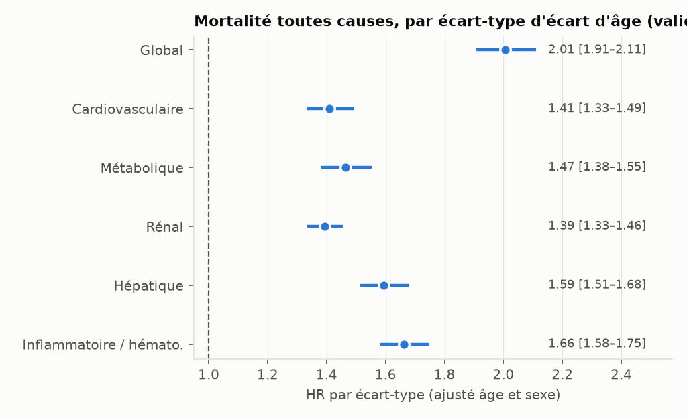
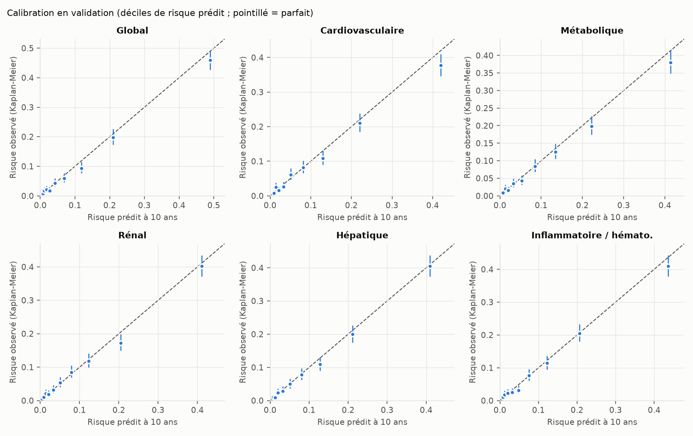
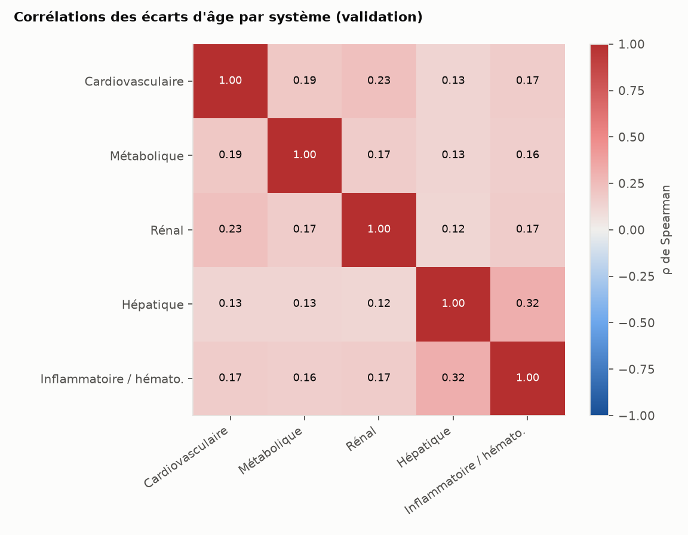
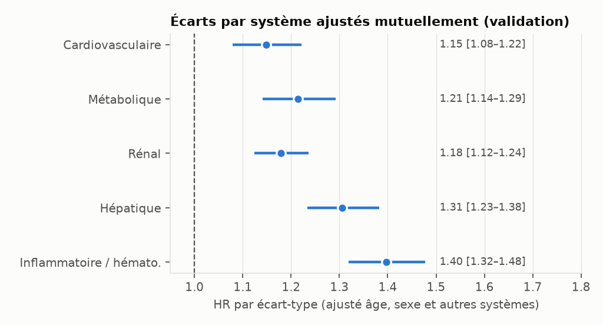

# Résultats de validation — panel `checkup_standard`

Rapport généré automatiquement par `python -m aging_clock validate --panel checkup_standard`.
Toutes les figures et tables sont dans ce dossier (CSV = vue tableau des figures).

> **Le panel a évolué depuis le jalon 1** (ajout de l'ACR urinaire au système rénal et de la
> fréquence cardiaque au système cardiovasculaire, décidés par validation croisée sur
> 1999-2006 uniquement). La cohorte 2007-2010 avait déjà été consultée au jalon 1 ; ce
> passage est l'unique consultation avec le panel final. Voir `DECISIONS.md`.
> Résultats du jalon 1 archivés dans `reports/archive/jalon1_checkup_standard/`.

- Développement : cycles NHANES 1999, 2001, 2003, 2005 ; validation temporelle : 2007, 2009.
- Mortalité : Linked Mortality Files 2019 (NCHS). Horizon de l'âge biologique : 10 ans.
- Pénalisation ridge des marqueurs choisie par validation croisée sur le développement : 0.0.
- IC à 95 % par bootstrap (1000 répliques ; 300 pour les sensibilités) ; graine 42.
- Empreinte SHA-256 du panel : `b01418dae864d6f6…`.

## Population

| etape | n |
|---|---|
| participants NHANES | 62160 |
| age 20-79 ans | 29725 |
| eligibles au chainage mortalite, suivi > 0 | 28396 |
| hors femmes enceintes | 27175 |
| cas complets sur le panel | 23129 |

| echantillon | n | deces | suivi_median_ans | age_moyen | pct_femmes | cycles |
|---|---|---|---|---|---|---|
| developpement | 13882 | 2785 | 16.1 | 47.4 | 48.7 | 1999, 2001, 2003, 2005 |
| validation | 9247 | 972 | 10.7 | 47.9 | 50.2 | 2007, 2009 |

## Discrimination et association (validation)

C de référence (Cox âge + sexe) : **0.807 [0.794; 0.819]**.

| Score | C (IC95) | Gain de C vs âge + sexe (IC95) | HR par ET d'écart (IC95) | ET de l'écart (ans) |
|---|---|---|---|---|
| Global | 0.853 [0.841; 0.864] | 0.046 [0.040; 0.053] | 2.01 [1.91; 2.11] | 7.5 |
| Cardiovasculaire | 0.819 [0.806; 0.831] | 0.012 [0.008; 0.015] | 1.41 [1.33; 1.49] | 3.7 |
| Métabolique | 0.819 [0.807; 0.832] | 0.013 [0.009; 0.016] | 1.47 [1.38; 1.55] | 3.9 |
| Rénal | 0.820 [0.807; 0.833] | 0.013 [0.010; 0.017] | 1.39 [1.33; 1.46] | 3.4 |
| Hépatique | 0.830 [0.819; 0.842] | 0.024 [0.019; 0.028] | 1.59 [1.51; 1.68] | 4.3 |
| Inflammatoire / hémato. | 0.833 [0.820; 0.845] | 0.026 [0.021; 0.031] | 1.66 [1.58; 1.75] | 5.1 |

HR par écart-type de l'écart d'âge, ajusté sur l'âge et le sexe, Cox ajusté dans l'échantillon de validation.

## Calibration à 10 ans (validation)

| Score | Risque prédit moyen | Risque observé (KM) | Observé / prédit | Pente (IC95) | Écart absolu moyen (déciles) |
|---|---|---|---|---|---|
| Global | 0.100 | 0.092 | 0.92 | 0.99 [0.94; 1.04] | 0.010 |
| Cardiovasculaire | 0.099 | 0.092 | 0.93 | 0.97 [0.92; 1.03] | 0.011 |
| Métabolique | 0.099 | 0.092 | 0.93 | 0.99 [0.93; 1.04] | 0.010 |
| Rénal | 0.095 | 0.092 | 0.97 | 0.99 [0.93; 1.05] | 0.007 |
| Hépatique | 0.096 | 0.092 | 0.96 | 1.02 [0.96; 1.08] | 0.005 |
| Inflammatoire / hémato. | 0.096 | 0.092 | 0.95 | 0.99 [0.93; 1.04] | 0.007 |

Pente = coefficient du log(-log(1 - risque prédit)) dans un Cox de validation (1 = idéal).

## Indépendance des écarts par système (validation)

Corrélations de Spearman entre écarts d'âge par système :

|  | Cardiovasculaire | Métabolique | Rénal | Hépatique | Inflammatoire / hémato. |
|---|---|---|---|---|---|
| Cardiovasculaire | 1.00 | 0.19 | 0.23 | 0.13 | 0.17 |
| Métabolique | 0.19 | 1.00 | 0.17 | 0.13 | 0.16 |
| Rénal | 0.23 | 0.17 | 1.00 | 0.12 | 0.17 |
| Hépatique | 0.13 | 0.13 | 0.12 | 1.00 | 0.32 |
| Inflammatoire / hémato. | 0.17 | 0.16 | 0.17 | 0.32 | 1.00 |

Cox avec tous les écarts par système ensemble (ajusté âge et sexe) :

| Système | HR par ET, ajusté mutuellement (IC95) | p |
|---|---|---|
| Cardiovasculaire | 1.15 [1.08; 1.22] | 1.3e-05 |
| Métabolique | 1.21 [1.14; 1.29] | 1.0e-09 |
| Rénal | 1.18 [1.12; 1.24] | 1.4e-11 |
| Hépatique | 1.31 [1.23; 1.38] | 3.5e-20 |
| Inflammatoire / hémato. | 1.40 [1.32; 1.48] | 6.5e-31 |

## Sensibilités

« figé » = modèle principal appliqué au sous-échantillon de validation ;
« ré-entraîné » = modèle ré-entraîné sur le développement filtré de la même façon.
Pour les causes spécifiques, les décès d'autres causes sont censurés.

| scenario | modele | Score | n | deces | C | C_ic95 | dC | dC_ic95 | HR_par_ET | HR_ic95 |
|---|---|---|---|---|---|---|---|---|---|---|
| principal | fige | Global | 9247 | 972 | 0.853 | [0.841; 0.864] | 0.046 | [0.040; 0.053] | 2.007 | [1.91; 2.11] |
| principal | fige | Cardiovasculaire | 9247 | 972 | 0.819 | [0.807; 0.831] | 0.012 | [0.008; 0.015] | 1.410 | [1.33; 1.49] |
| principal | fige | Métabolique | 9247 | 972 | 0.819 | [0.807; 0.832] | 0.013 | [0.009; 0.016] | 1.465 | [1.38; 1.55] |
| principal | fige | Rénal | 9247 | 972 | 0.820 | [0.808; 0.832] | 0.013 | [0.010; 0.017] | 1.393 | [1.33; 1.46] |
| principal | fige | Hépatique | 9247 | 972 | 0.830 | [0.819; 0.843] | 0.024 | [0.019; 0.028] | 1.595 | [1.51; 1.68] |
| principal | fige | Inflammatoire / hémato. | 9247 | 972 | 0.833 | [0.820; 0.844] | 0.026 | [0.021; 0.031] | 1.663 | [1.58; 1.75] |
| 1. sans deces < 24 mois | fige | Global | 9143 | 868 | 0.856 | [0.844; 0.868] | 0.046 | [0.038; 0.052] | 1.996 | [1.89; 2.11] |
| 1. sans deces < 24 mois | fige | Cardiovasculaire | 9143 | 868 | 0.821 | [0.806; 0.835] | 0.011 | [0.007; 0.014] | 1.385 | [1.30; 1.47] |
| 1. sans deces < 24 mois | fige | Métabolique | 9143 | 868 | 0.824 | [0.809; 0.838] | 0.014 | [0.009; 0.017] | 1.488 | [1.40; 1.58] |
| 1. sans deces < 24 mois | fige | Rénal | 9143 | 868 | 0.823 | [0.810; 0.837] | 0.013 | [0.009; 0.017] | 1.390 | [1.33; 1.46] |
| 1. sans deces < 24 mois | fige | Hépatique | 9143 | 868 | 0.833 | [0.820; 0.845] | 0.023 | [0.018; 0.027] | 1.575 | [1.49; 1.66] |
| 1. sans deces < 24 mois | fige | Inflammatoire / hémato. | 9143 | 868 | 0.836 | [0.822; 0.850] | 0.025 | [0.020; 0.032] | 1.646 | [1.56; 1.74] |
| 1. sans deces < 24 mois | re-entraine | Global | 9143 | 868 | 0.855 | [0.843; 0.867] | 0.045 | [0.038; 0.052] | 1.990 | [1.89; 2.10] |
| 1. sans deces < 24 mois | re-entraine | Cardiovasculaire | 9143 | 868 | 0.821 | [0.806; 0.834] | 0.011 | [0.007; 0.014] | 1.375 | [1.29; 1.46] |
| 1. sans deces < 24 mois | re-entraine | Métabolique | 9143 | 868 | 0.823 | [0.809; 0.838] | 0.013 | [0.009; 0.017] | 1.486 | [1.40; 1.58] |
| 1. sans deces < 24 mois | re-entraine | Rénal | 9143 | 868 | 0.823 | [0.810; 0.837] | 0.013 | [0.009; 0.016] | 1.388 | [1.33; 1.45] |
| 1. sans deces < 24 mois | re-entraine | Hépatique | 9143 | 868 | 0.832 | [0.819; 0.845] | 0.022 | [0.018; 0.026] | 1.578 | [1.49; 1.67] |
| 1. sans deces < 24 mois | re-entraine | Inflammatoire / hémato. | 9143 | 868 | 0.835 | [0.821; 0.849] | 0.025 | [0.019; 0.031] | 1.649 | [1.56; 1.74] |
| 2. sans antecedent declare | fige | Global | 7123 | 431 | 0.838 | [0.815; 0.856] | 0.042 | [0.030; 0.052] | 2.008 | [1.86; 2.17] |
| 2. sans antecedent declare | fige | Cardiovasculaire | 7123 | 431 | 0.806 | [0.784; 0.826] | 0.010 | [0.005; 0.016] | 1.385 | [1.27; 1.51] |
| 2. sans antecedent declare | fige | Métabolique | 7123 | 431 | 0.804 | [0.781; 0.824] | 0.008 | [0.003; 0.014] | 1.430 | [1.31; 1.56] |
| 2. sans antecedent declare | fige | Rénal | 7123 | 431 | 0.804 | [0.780; 0.824] | 0.008 | [0.004; 0.014] | 1.333 | [1.25; 1.42] |
| 2. sans antecedent declare | fige | Hépatique | 7123 | 431 | 0.818 | [0.796; 0.836] | 0.022 | [0.015; 0.029] | 1.565 | [1.45; 1.69] |
| 2. sans antecedent declare | fige | Inflammatoire / hémato. | 7123 | 431 | 0.822 | [0.798; 0.840] | 0.026 | [0.018; 0.033] | 1.646 | [1.53; 1.78] |
| 2. sans antecedent declare | re-entraine | Global | 7123 | 431 | 0.837 | [0.815; 0.855] | 0.041 | [0.029; 0.050] | 2.004 | [1.85; 2.17] |
| 2. sans antecedent declare | re-entraine | Cardiovasculaire | 7123 | 431 | 0.808 | [0.786; 0.828] | 0.012 | [0.006; 0.018] | 1.429 | [1.31; 1.56] |
| 2. sans antecedent declare | re-entraine | Métabolique | 7123 | 431 | 0.804 | [0.782; 0.825] | 0.008 | [0.003; 0.014] | 1.431 | [1.31; 1.56] |
| 2. sans antecedent declare | re-entraine | Rénal | 7123 | 431 | 0.804 | [0.780; 0.823] | 0.008 | [0.004; 0.012] | 1.359 | [1.26; 1.46] |
| 2. sans antecedent declare | re-entraine | Hépatique | 7123 | 431 | 0.818 | [0.796; 0.837] | 0.022 | [0.015; 0.029] | 1.587 | [1.47; 1.71] |
| 2. sans antecedent declare | re-entraine | Inflammatoire / hémato. | 7123 | 431 | 0.821 | [0.797; 0.840] | 0.025 | [0.017; 0.032] | 1.634 | [1.52; 1.76] |
| 4. deces cardiovasculaire (cause specifique) | fige | Global | 9247 | 251 | 0.886 | [0.868; 0.902] | 0.045 | [0.029; 0.058] | 1.990 | [1.80; 2.20] |
| 4. deces cardiovasculaire (cause specifique) | fige | Cardiovasculaire | 9247 | 251 | 0.851 | [0.831; 0.871] | 0.010 | [0.003; 0.017] | 1.374 | [1.22; 1.54] |
| 4. deces cardiovasculaire (cause specifique) | fige | Métabolique | 9247 | 251 | 0.850 | [0.830; 0.871] | 0.009 | [0.003; 0.016] | 1.433 | [1.27; 1.61] |
| 4. deces cardiovasculaire (cause specifique) | fige | Rénal | 9247 | 251 | 0.859 | [0.839; 0.879] | 0.019 | [0.011; 0.025] | 1.455 | [1.34; 1.58] |
| 4. deces cardiovasculaire (cause specifique) | fige | Hépatique | 9247 | 251 | 0.863 | [0.842; 0.880] | 0.022 | [0.012; 0.031] | 1.558 | [1.41; 1.73] |
| 4. deces cardiovasculaire (cause specifique) | fige | Inflammatoire / hémato. | 9247 | 251 | 0.867 | [0.848; 0.886] | 0.026 | [0.017; 0.036] | 1.680 | [1.53; 1.85] |
| 4. deces cancer (cause specifique) | fige | Global | 9247 | 287 | 0.847 | [0.826; 0.870] | 0.037 | [0.025; 0.049] | 1.835 | [1.67; 2.02] |
| 4. deces cancer (cause specifique) | fige | Cardiovasculaire | 9247 | 287 | 0.818 | [0.797; 0.843] | 0.009 | [0.003; 0.015] | 1.333 | [1.20; 1.48] |
| 4. deces cancer (cause specifique) | fige | Métabolique | 9247 | 287 | 0.816 | [0.795; 0.838] | 0.006 | [-0.000; 0.012] | 1.308 | [1.17; 1.46] |
| 4. deces cancer (cause specifique) | fige | Rénal | 9247 | 287 | 0.816 | [0.794; 0.838] | 0.006 | [0.001; 0.012] | 1.232 | [1.13; 1.35] |
| 4. deces cancer (cause specifique) | fige | Hépatique | 9247 | 287 | 0.831 | [0.811; 0.853] | 0.022 | [0.014; 0.030] | 1.588 | [1.44; 1.75] |
| 4. deces cancer (cause specifique) | fige | Inflammatoire / hémato. | 9247 | 287 | 0.832 | [0.812; 0.856] | 0.023 | [0.014; 0.032] | 1.607 | [1.46; 1.76] |
| 4. deces autre (cause specifique) | fige | Global | 9247 | 434 | 0.837 | [0.818; 0.859] | 0.053 | [0.044; 0.063] | 2.128 | [1.98; 2.29] |
| 4. deces autre (cause specifique) | fige | Cardiovasculaire | 9247 | 434 | 0.799 | [0.778; 0.821] | 0.015 | [0.010; 0.021] | 1.482 | [1.36; 1.61] |
| 4. deces autre (cause specifique) | fige | Métabolique | 9247 | 434 | 0.803 | [0.782; 0.824] | 0.019 | [0.013; 0.025] | 1.590 | [1.46; 1.73] |
| 4. deces autre (cause specifique) | fige | Rénal | 9247 | 434 | 0.799 | [0.778; 0.821] | 0.015 | [0.010; 0.021] | 1.459 | [1.37; 1.56] |
| 4. deces autre (cause specifique) | fige | Hépatique | 9247 | 434 | 0.810 | [0.789; 0.831] | 0.026 | [0.020; 0.033] | 1.619 | [1.50; 1.75] |
| 4. deces autre (cause specifique) | fige | Inflammatoire / hémato. | 9247 | 434 | 0.812 | [0.790; 0.832] | 0.028 | [0.019; 0.036] | 1.688 | [1.57; 1.82] |

## Effet de la correction du protocole (prototype)

| protocole | n_eval | deces_eval | C_complet | C_age | dC_age_ecart | HR_par_an_ecart | ET_ecart_ans |
|---|---|---|---|---|---|---|---|
| A. prototype (avec fuites) | 1129 |  | 0.867 | 0.847 | 0.019 | 1.100 |  |
| B. memes donnees, sans fuite | 1128 | 146.000 | 0.862 | 0.837 | 0.025 | 1.103 | 6.500 |
| C. 10 marqueurs, validation temporelle | 10088 | 1141.000 | 0.839 | 0.803 | 0.036 | 1.107 | 5.298 |
| D. panel checkup_standard, validation temporelle | 9247 | 972.000 | 0.853 | 0.807 | 0.046 | 1.098 | 7.479 |

`C_complet` : C du risque prédit par le modèle complet. `C_age` : Cox âge seul
(âge + sexe pour le panel check-up). `dC_age_ecart` : gain de C quand on ajoute
l'écart d'âge à ce Cox. A = valeurs du prototype relancé tel quel.
