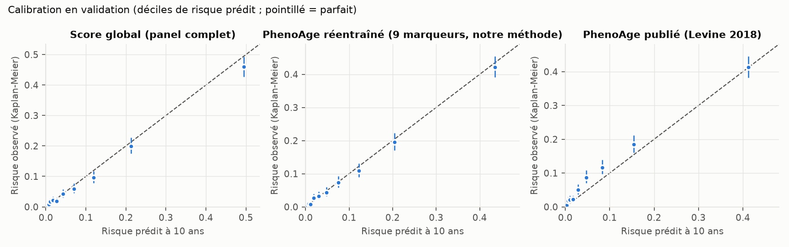

# Benchmark PhenoAge — validation 2007-2010

Panel et modèle principaux gelés (point 4) ; protocole écrit avant exécution (`DECISIONS.md`, 5a).
Trois scores sur les mêmes participants. Différences de C par bootstrap **apparié**
(mêmes tirages pour les scores comparés).

- **PhenoAge publié**, sans réentraînement. Sources :
  - poids des marqueurs : Levine et al. 2018, *Aging* 10(4):573-591, tableau 1
    ([doi:10.18632/aging.101414](https://doi.org/10.18632/aging.101414)) ;
  - risque à 10 ans : M = 1 − exp(−1,51714·exp(xb)/0,0076927) (correction de Liu et al.,
    *PLoS Med* 2019, [doi:10.1371/journal.pmed.1002760](https://doi.org/10.1371/journal.pmed.1002760)) ;
  - conversion en années : supplément 1 de Levine et al. 2018 (lu le 2026-11-09) :
    PhenoAge = 141,50225 + ln(−0,00553·ln(1 − M))/0,090165.
  - La correction de Liu 2019 imprime 141,50 et 0,09165 (probable faute de frappe), constantes
    utilisées dans une première exécution (`DECISIONS.md`). Passer de l'une à l'autre est une
    transformation affine de PhenoAge : **seules les valeurs en années changent** (PhenoAge moyen,
    accélération en années et son écart-type). Le C, le HR par écart-type d'accélération et la
    calibration (calculée sur M, avant conversion) sont identiques.
- **PhenoAge réentraîné** : ses 9 marqueurs, méthode du score principal (Cox âge + sexe,
  transformations du panel, pénalisation par CV sur 1999-2006).
- Accélération : écart d'âge pour nos scores ; résidu PhenoAge ~ âge (régression estimée sur le
  développement) pour PhenoAge publié. HR par écart-type, ajusté âge + sexe.
- Calibration à 10 ans : M (risque à 10 ans) pour PhenoAge publié ; risque à 10 ans du Cox pour
  les versions réentraînées.
- Limite : glycémie non à jeun dans NHANES ici ; PhenoAge a été conçu sur des sujets à jeun.

## Validation complète

C de référence (Cox âge + sexe) : 0.807 [0.794; 0.819].

| Score | n | Décès | C (IC95) | Gain de C vs âge + sexe | HR / ET d'accélération | Obs./prédit 10 ans | Pente |
|---|---|---|---|---|---|---|---|
| Score global (panel complet) | 9276 | 978 | 0.853 [0.842; 0.865] | +0.047 [0.040; 0.053] | 2.01 [1.92; 2.12] | 0.91 | 0.99 [0.94; 1.04] |
| PhenoAge réentraîné (9 marqueurs, notre méthode) | 9276 | 978 | 0.837 [0.825; 0.849] | +0.030 [0.025; 0.035] | 1.75 [1.66; 1.84] | 0.96 | 1.00 [0.95; 1.06] |
| PhenoAge publié (Levine 2018) | 9276 | 978 | 0.832 [0.820; 0.844] | +0.025 [0.018; 0.032] | 1.49 [1.43; 1.54] | 1.21 | 0.71 [0.68; 0.75] |

| Comparaison | Différence de C (IC95, apparié) | p bootstrap |
|---|---|---|
| Score global (panel complet) − PhenoAge publié (Levine 2018) | +0.0216 [+0.0159; +0.0268] | < 0,001 |
| Score global (panel complet) − PhenoAge réentraîné (9 marqueurs, notre méthode) | +0.0164 [+0.0121; +0.0206] | < 0,001 |
| PhenoAge réentraîné (9 marqueurs, notre méthode) − PhenoAge publié (Levine 2018) | +0.0052 [+0.0019; +0.0086] | 0.006 |

## Sans antécédent déclaré

C de référence (Cox âge + sexe) : 0.796 [0.773; 0.818].

| Score | n | Décès | C (IC95) | Gain de C vs âge + sexe | HR / ET d'accélération | Obs./prédit 10 ans | Pente |
|---|---|---|---|---|---|---|---|
| Score global (panel complet) | 7144 | 434 | 0.838 [0.819; 0.859] | +0.042 [0.031; 0.053] | 2.02 [1.87; 2.18] | 0.81 | 0.99 [0.92; 1.07] |
| PhenoAge réentraîné (9 marqueurs, notre méthode) | 7144 | 434 | 0.823 [0.802; 0.843] | +0.027 [0.018; 0.035] | 1.70 [1.57; 1.83] | 0.83 | 0.97 [0.90; 1.05] |
| PhenoAge publié (Levine 2018) | 7144 | 434 | 0.816 [0.796; 0.837] | +0.020 [0.011; 0.029] | 1.39 [1.32; 1.46] | 1.17 | 0.73 [0.68; 0.78] |

| Comparaison | Différence de C (IC95, apparié) | p bootstrap |
|---|---|---|
| Score global (panel complet) − PhenoAge publié (Levine 2018) | +0.0222 [+0.0134; +0.0304] | < 0,001 |
| Score global (panel complet) − PhenoAge réentraîné (9 marqueurs, notre méthode) | +0.0153 [+0.0085; +0.0220] | < 0,001 |
| PhenoAge réentraîné (9 marqueurs, notre méthode) − PhenoAge publié (Levine 2018) | +0.0069 [+0.0021; +0.0111] | 0.006 |

## Notes

- PhenoAge publié moyen en validation : 42.5 ans pour un âge moyen de 48.0 ans (valeur en années : dépend des constantes de conversion).
- Corrélation entre l'écart global et l'accélération PhenoAge : 0.63.
- Pénalisation retenue pour PhenoAge réentraîné (CV 1999-2006) : 0.003.
- Bootstrap : 1000 tirages appariés, graine 42.

