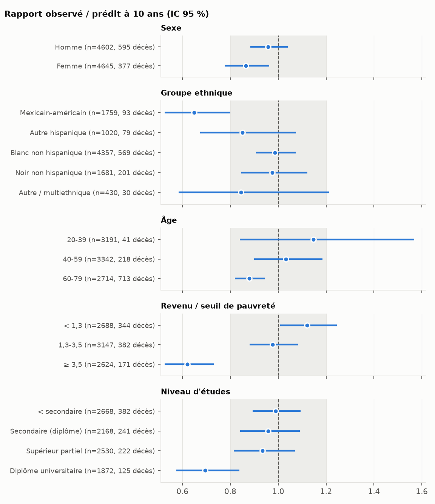
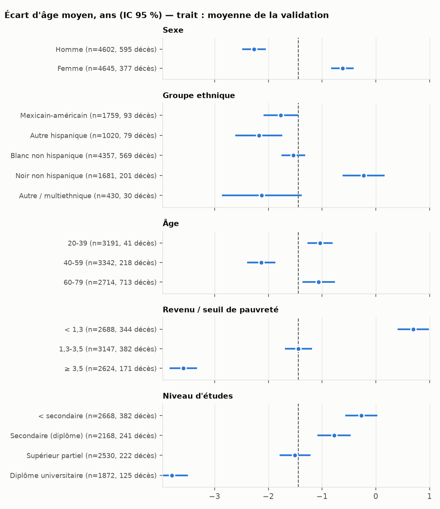

# Audit d'équité — validation 2007-2010

Modèle gelé (point 4), score global, analyses non pondérées. Protocole et règle d'interprétation
fixés avant exécution (`DECISIONS.md`, 5b). n = 9247 ; écart d'âge moyen de la
validation : -1.44 an(s). Valeurs manquantes par axe : Revenu / seuil de pauvreté : 788, Niveau d'études : 9.

**Règle** — défaut de calibration : IC du rapport observé/prédit (O/P) excluant 1 et
|O/P − 1| > 0,20, ou IC de la pente excluant 1 et pente hors [0,80 ; 1,20] ; défaut de
discrimination : IC du gain de C incluant 0 ; différence de risque réelle : écart moyen différent
de la moyenne de validation sans défaut du modèle ; < 50 décès : effectif insuffisant.

| Axe | Groupe | n | Décès | C | Gain de C vs âge + sexe | Obs. / prédit 10 ans | Pente | Écart moyen (ans) | Écart médian [Q1; Q3] | Verdict (règle pré-enregistrée) |
|---|---|---|---|---|---|---|---|---|---|---|
| Sexe | Homme | 4602 | 595 | 0.847 [0.832; 0.861] | +0.048 [+0.039; +0.056] | 0.96 [0.88; 1.04] | 0.94 [0.88; 1.00] | -2.3 [-2.5; -2.0] | -3.3 [-7.5; +1.9] | différence de risque réelle (bien calibré) |
| Sexe | Femme | 4645 | 377 | 0.853 [0.835; 0.872] | +0.048 [+0.036; +0.060] | 0.86 [0.78; 0.96] | 1.07 [0.99; 1.15] | -0.6 [-0.8; -0.4] | -1.3 [-5.7; +3.4] | différence de risque réelle (bien calibré) |
| Groupe ethnique | Mexicain-américain | 1759 | 93 | 0.842 [0.792; 0.885] | +0.045 [+0.020; +0.069] | 0.65 [0.53; 0.80] | 0.97 [0.82; 1.11] | -1.8 [-2.1; -1.5] | -2.4 [-6.7; +2.2] | défaut du modèle (calibration) |
| Groupe ethnique | Autre hispanique | 1020 | 79 | 0.888 [0.857; 0.917] | +0.051 [+0.030; +0.073] | 0.85 [0.67; 1.07] | 1.19 [1.01; 1.38] | -2.2 [-2.6; -1.7] | -3.0 [-7.3; +1.8] | différence de risque réelle (bien calibré) |
| Groupe ethnique | Blanc non hispanique | 4357 | 569 | 0.849 [0.833; 0.864] | +0.049 [+0.040; +0.059] | 0.99 [0.91; 1.07] | 0.95 [0.89; 1.01] | -1.5 [-1.8; -1.3] | -2.4 [-6.7; +2.6] | pas de différence |
| Groupe ethnique | Noir non hispanique | 1681 | 201 | 0.829 [0.804; 0.857] | +0.053 [+0.036; +0.069] | 0.98 [0.85; 1.12] | 0.97 [0.86; 1.08] | -0.2 [-0.6; +0.2] | -0.9 [-5.9; +4.3] | différence de risque réelle (bien calibré) |
| Groupe ethnique | Autre / multiethnique | 430 | 30 | 0.858 [0.760; 0.930] | -0.004 [-0.036; +0.023] | 0.84 [0.58; 1.21] | 1.16 [0.88; 1.44] | -2.1 [-2.9; -1.4] | -2.9 [-7.5; +2.4] | effectif insuffisant |
| Âge | 20-39 | 3191 | 41 | 0.720 [0.643; 0.797] | +0.095 [+0.017; +0.174] | 1.15 [0.84; 1.57] | 1.00 [0.67; 1.33] | -1.0 [-1.3; -0.8] | -1.6 [-5.7; +2.8] | effectif insuffisant |
| Âge | 40-59 | 3342 | 218 | 0.773 [0.740; 0.803] | +0.115 [+0.083; +0.150] | 1.03 [0.90; 1.18] | 1.21 [1.07; 1.34] | -2.1 [-2.4; -1.9] | -3.0 [-7.7; +2.2] | défaut du modèle (calibration) |
| Âge | 60-79 | 2714 | 713 | 0.758 [0.740; 0.775] | +0.102 [+0.084; +0.119] | 0.88 [0.82; 0.94] | 1.02 [0.94; 1.09] | -1.1 [-1.4; -0.8] | -2.3 [-6.7; +3.3] | différence de risque réelle (bien calibré) |
| Revenu / seuil de pauvreté | < 1,3 | 2688 | 344 | 0.853 [0.834; 0.871] | +0.037 [+0.026; +0.047] | 1.12 [1.01; 1.24] | 0.96 [0.88; 1.04] | +0.7 [+0.4; +1.0] | -0.1 [-4.5; +5.2] | différence de risque réelle (bien calibré) |
| Revenu / seuil de pauvreté | 1,3-3,5 | 3147 | 382 | 0.848 [0.830; 0.866] | +0.037 [+0.026; +0.047] | 0.98 [0.88; 1.08] | 0.95 [0.87; 1.03] | -1.4 [-1.7; -1.2] | -2.2 [-6.5; +2.8] | pas de différence |
| Revenu / seuil de pauvreté | ≥ 3,5 | 2624 | 171 | 0.842 [0.812; 0.871] | +0.042 [+0.025; +0.058] | 0.62 [0.53; 0.73] | 0.99 [0.88; 1.10] | -3.6 [-3.8; -3.3] | -4.3 [-8.3; +0.2] | défaut du modèle (calibration) |
| Niveau d'études | < secondaire | 2668 | 382 | 0.839 [0.821; 0.860] | +0.050 [+0.039; +0.062] | 0.99 [0.89; 1.09] | 0.96 [0.88; 1.04] | -0.3 [-0.6; +0.0] | -1.2 [-5.9; +4.2] | différence de risque réelle (bien calibré) |
| Niveau d'études | Secondaire (diplôme) | 2168 | 241 | 0.843 [0.819; 0.867] | +0.041 [+0.028; +0.054] | 0.96 [0.84; 1.09] | 0.97 [0.87; 1.07] | -0.8 [-1.1; -0.5] | -1.6 [-5.9; +3.5] | différence de risque réelle (bien calibré) |
| Niveau d'études | Supérieur partiel | 2530 | 222 | 0.860 [0.835; 0.882] | +0.044 [+0.029; +0.059] | 0.93 [0.81; 1.07] | 1.04 [0.94; 1.14] | -1.5 [-1.8; -1.2] | -2.3 [-6.7; +2.6] | pas de différence |
| Niveau d'études | Diplôme universitaire | 1872 | 125 | 0.864 [0.833; 0.892] | +0.037 [+0.020; +0.054] | 0.69 [0.58; 0.84] | 0.99 [0.86; 1.12] | -3.8 [-4.1; -3.5] | -4.4 [-8.2; -0.1] | défaut du modèle (calibration) |

Écarts moyens par système et par groupe : `ecarts_par_systeme.csv`.
Interprétation (écrite après lecture des résultats) : `INTERPRETATION.md`.
