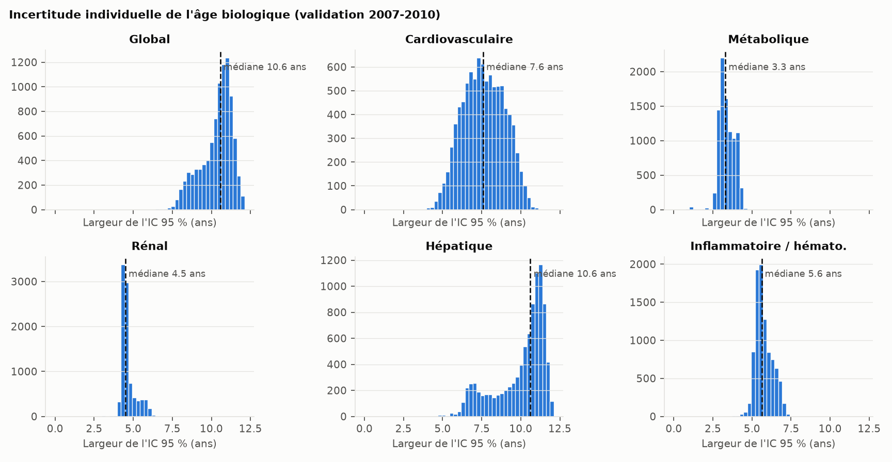
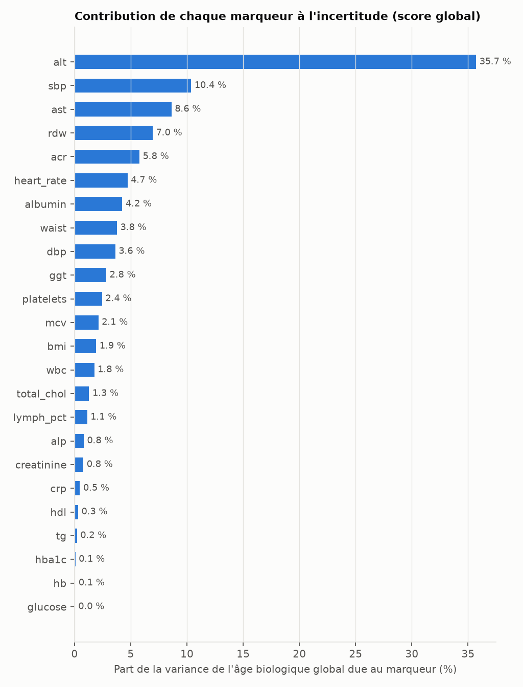

# Précision individuelle de l'âge biologique

Analyse **descriptive** (protocole : `DECISIONS.md`) : le modèle est figé et rien n'en découle pour
lui. Calculs avec le modèle exporté (`models/checkup_standard_v1.json`) et le module autonome ;
validation 2007-2010, n = 9247 ; 1000 remesures simulées par personne, graine
2026.

## Hypothèse

Pour chaque personne, on simule des « remesures » de ses biomarqueurs avec un bruit multiplicatif
log-normal de médiane 1 et de CV total = racine(CV_I² + CV_A²), indépendant entre marqueurs.
**On simule autour de la valeur observée, qui contient déjà du bruit** : la dispersion obtenue est
celle qu'aurait une nouvelle mesure de la même personne, pas l'écart entre la mesure et une
« vraie » valeur. L'âge et le sexe ne sont pas bruités.

## Variabilités utilisées

Fichier `config/variability.yaml` (hors dépôt public, licence EFLM ; gabarit
`config/variability.example.yaml`). Valeurs EFLM citées avec l'accord des conditions d'usage
académique de la base (source : EFLM Biological Variation Database, biologicalvariation.eu).

| Variable | CV_I (%) | Bornes | CV_A (%) | Source |
|---|---|---|---|---|
| albumin | 3.5 | 2.5 – 3.5 | 1.3 | Lacher DA, Hughes JP, Carroll MD. National Health Statistics Reports no 21, NCHS, 2010 (domaine public) ; CV_w net de CV_a, NHANES 1999-2002, ~19 jours ; borne basse : EFLM Biological Variation Database, biologicalvariation.eu, meta-analyse (consultee le 2026-11-09) |
| creatinine | 6.7 | 4.4 – 6.7 | 4.6 | Lacher DA, Hughes JP, Carroll MD. National Health Statistics Reports no 21, NCHS, 2010 (domaine public) ; CV_w net de CV_a, NHANES 1999-2002, ~19 jours ; borne basse : EFLM Biological Variation Database, biologicalvariation.eu, meta-analyse (consultee le 2026-11-09) |
| glucose | 7.5 | 4.9 – 7.5 | 1.5 | Lacher DA, Hughes JP, Carroll MD. National Health Statistics Reports no 21, NCHS, 2010 (domaine public) ; CV_w net de CV_a, NHANES 1999-2002, ~19 jours (non a jeun) ; borne basse : EFLM Biological Variation Database, biologicalvariation.eu, meta-analyse (consultee le 2026-11-09) (a jeun) |
| tg | 27.8 | 19.8 – 27.8 | 1.9 | Lacher DA, Hughes JP, Carroll MD. National Health Statistics Reports no 21, NCHS, 2010 (domaine public) ; CV_w net de CV_a, NHANES 1999-2002, ~19 jours (non a jeun) ; borne basse : EFLM Biological Variation Database, biologicalvariation.eu, meta-analyse (consultee le 2026-11-09) (a jeun) |
| total_chol | 6.9 | 5.4 – 6.9 | 1.5 | Lacher DA, Hughes JP, Carroll MD. National Health Statistics Reports no 21, NCHS, 2010 (domaine public) ; CV_w net de CV_a, NHANES 1999-2002, ~19 jours ; borne basse : EFLM Biological Variation Database, biologicalvariation.eu, meta-analyse (consultee le 2026-11-09) |
| alp | 8.1 | 5.3 – 8.1 | 2.1 | Lacher DA, Hughes JP, Carroll MD. National Health Statistics Reports no 21, NCHS, 2010 (domaine public) ; CV_w net de CV_a, NHANES 1999-2002, ~19 jours ; borne basse : Carobene A et al. Clin Chem 2017, doi:10.1373/clinchem.2016.269811 |
| alt | 20.3 | 12.4 – 20.3 | 4.0 | Lacher DA, Hughes JP, Carroll MD. National Health Statistics Reports no 21, NCHS, 2010 (domaine public) ; CV_w net de CV_a, NHANES 1999-2002, ~19 jours ; borne basse : EFLM Biological Variation Database, biologicalvariation.eu, meta-analyse (consultee le 2026-11-09) |
| ast | 15.5 | 8.4 – 15.5 | 3.1 | Lacher DA, Hughes JP, Carroll MD. National Health Statistics Reports no 21, NCHS, 2010 (domaine public) ; CV_w net de CV_a, NHANES 1999-2002, ~19 jours ; borne basse : EFLM Biological Variation Database, biologicalvariation.eu, meta-analyse (consultee le 2026-11-09) |
| ggt | 16.2 | 8.2 – 16.2 | 3.0 | Lacher DA, Hughes JP, Carroll MD. National Health Statistics Reports no 21, NCHS, 2010 (domaine public) ; CV_w net de CV_a, NHANES 1999-2002, ~19 jours ; borne basse : EFLM Biological Variation Database, biologicalvariation.eu, meta-analyse (consultee le 2026-11-09) |
| hdl | 5.7 | 4.7 – 7.8 | 2.9 | EFLM Biological Variation Database, biologicalvariation.eu, meta-analyse (consultee le 2026-11-09) [IC 4,7 ; 7,8] |
| crp | 34.7 | 29.4 – 74.4 | 17.4 | EFLM Biological Variation Database, biologicalvariation.eu, meta-analyse (consultee le 2026-11-09) [IC 29,4 ; 74,4] |
| hba1c | 1.2 | 0.2 – 7.0 | 0.6 | EFLM Biological Variation Database, biologicalvariation.eu, meta-analyse (consultee le 2026-11-09) HbA1c (NGSP) [IC 0,2 ; 7,0] ; IFCC : 1,6 [1,3 ; 2,5] |
| wbc | 11.1 | 8.9 – 15.9 | 5.5 | EFLM Biological Variation Database, biologicalvariation.eu, meta-analyse (consultee le 2026-11-09) leucocytes [IC 8,9 ; 15,9] |
| lymph_pct | 10.9 | 5.0 – 14.7 | 5.5 | EFLM Biological Variation Database, biologicalvariation.eu, meta-analyse (consultee le 2026-11-09) lymphocytes (NOMBRE, pas le %) [IC 9,8 ; 14,7] ; approximation, borne basse 5,0 fixee a priori |
| rdw | 1.7 | 1.4 – 3.7 | 0.8 | EFLM Biological Variation Database, biologicalvariation.eu, meta-analyse (consultee le 2026-11-09) RDW-SD (pas le RDW en %) [IC 1,4 ; 3,7] ; approximation |
| mcv | 0.8 | 0.6 – 1.6 | 0.4 | EFLM Biological Variation Database, biologicalvariation.eu, meta-analyse (consultee le 2026-11-09) [IC 0,6 ; 1,6] |
| hb | 2.7 | 1.7 – 3.6 | 1.4 | EFLM Biological Variation Database, biologicalvariation.eu, meta-analyse (consultee le 2026-11-09) [IC 1,7 ; 3,6] |
| platelets | 7.2 | 6.6 – 9.9 | 3.6 | EFLM Biological Variation Database, biologicalvariation.eu, meta-analyse (consultee le 2026-11-09) [IC 6,6 ; 9,9] |
| acr | 40.0 | 25.0 – 60.0 | 0.0 | VALEUR DE TRAVAIL : aucune etude eligible a la meta-analyse (Aslan B et al. Clin Chim Acta 2024, doi:10.1016/j.cca.2024.120032) |
| sbp | 8.6 | 2.0 – 10.0 | 0.0 | CV au cabinet entre visites (Br J Gen Pract 2010;60:675) ; borne basse : CV intra-visite NHANES de la moyenne de 3 mesures (3,54/racine(3)) |
| dbp | 8.6 | 3.9 – 10.0 | 0.0 | CV au cabinet entre visites (Br J Gen Pract 2010;60:675) ; borne basse : CV intra-visite NHANES de la moyenne de 3 mesures (6,78/racine(3)) |
| heart_rate | 8.0 | 5.0 – 11.0 | 0.0 | VALEUR DE TRAVAIL : ET jour a jour 3-5 bpm (PLoS One 2020, doi:10.1371/journal.pone.0227709, mesures par objets connectes) ; pouls clinique probablement plus variable |
| bmi | 1.5 | 1.0 – 3.0 | 0.0 | VALEUR DE TRAVAIL NON SOURCEE |
| waist | 2.0 | 1.0 – 3.0 | 0.0 | VALEUR DE TRAVAIL NON SOURCEE |

## Intervalles individuels

| Score | ET médian (ans) | IC 95 % : largeur médiane [Q1 ; Q3] (ans) | 90e centile de la largeur |
|---|---|---|---|
| Global | 2.7 | 10.6 [9.7 ; 11.0] | 11.4 |
| Cardiovasculaire | 2.0 | 7.6 [6.6 ; 8.6] | 9.4 |
| Métabolique | 0.8 | 3.3 [3.0 ; 3.8] | 4.1 |
| Rénal | 1.1 | 4.5 [4.4 ; 4.7] | 5.5 |
| Hépatique | 2.8 | 10.6 [9.1 ; 11.2] | 11.5 |
| Inflammatoire / hémato. | 1.4 | 5.6 [5.4 ; 6.1] | 6.6 |

## Changement significatif entre deux mesures

Écart minimal entre deux âges biologiques successifs d'une même personne pour conclure, à 95 %, à un
vrai changement (95e centile de |âge bio 1 − âge bio 2| sur 500 paires de remesures, par personne).

| Score | Changement significatif : médiane [Q1 ; Q3] (ans) | 1,96·√2·ET (médiane) |
|---|---|---|
| Global | 7.5 [6.9 ; 7.9] | 7.5 |
| Cardiovasculaire | 5.4 [4.7 ; 6.1] | 5.4 |
| Métabolique | 2.3 [2.1 ; 2.7] | 2.3 |
| Rénal | 3.2 [3.1 ; 3.4] | 3.2 |
| Hépatique | 7.5 [6.5 ; 8.0] | 7.6 |
| Inflammatoire / hémato. | 4.0 [3.8 ; 4.3] | 4.0 |

## Fiabilité et stabilité du classement

CCI ≈ 1 − variance due au bruit / variance de l'écart entre personnes (approximation : la variance
observée contient déjà du bruit). Bascule : part des paires de remesures où l'écart change de signe.

| Score | CCI | Bascule plus jeune / plus vieux (%) |
|---|---|---|
| Global | 0.87 | 15.7 |
| Cardiovasculaire | 0.71 | 22.9 |
| Métabolique | 0.95 | 9.5 |
| Rénal | 0.87 | 17.2 |
| Hépatique | 0.63 | 24.7 |
| Inflammatoire / hémato. | 0.92 | 12.9 |

Bascule par tranche d'écart observé (%) :

| score | < 1 an | 1-3 ans | 3-5 ans | ≥ 5 ans |
|---|---|---|---|---|
| Global | 47.2 | 36.1 | 15.8 | 1.5 |
| Cardiovasculaire | 45.1 | 29.3 | 8.1 | 0.6 |
| Métabolique | 39.4 | 5.6 | 0.0 | 0.0 |
| Rénal | 43.4 | 13.5 | 0.6 | 0.0 |
| Hépatique | 48.2 | 34.9 | 14.0 | 2.3 |
| Inflammatoire / hémato. | 45.5 | 18.8 | 1.5 | 0.0 |

## Contribution de chaque marqueur (% de la variance due au bruit)

Un seul marqueur bruité à la fois (200 tirages). Somme des variances par
marqueur / variance totale : Global 1.00, Cardiovasculaire 1.00, Métabolique 1.00, Rénal 1.00, Hépatique 1.00, Inflammatoire / hémato. 1.00 (≈ 1 si les contributions s'additionnent).

| Variable | Cardiovasculaire | Global | Hépatique | Inflammatoire / hémato. | Métabolique | Rénal |
|---|---|---|---|---|---|---|
| alt | 0.0 | 35.7 | 61.1 | 0.0 | 0.0 | 0.0 |
| sbp | 30.4 | 10.4 | 0.0 | 0.0 | 0.0 | 0.0 |
| ast | 0.0 | 8.6 | 12.3 | 0.0 | 0.0 | 0.0 |
| rdw | 0.0 | 7.0 | 0.0 | 31.7 | 0.0 | 0.0 |
| acr | 0.0 | 5.8 | 0.0 | 0.0 | 0.0 | 84.3 |
| heart_rate | 42.1 | 4.7 | 0.0 | 0.0 | 0.0 | 0.0 |
| albumin | 0.0 | 4.2 | 16.9 | 0.0 | 0.0 | 0.0 |
| waist | 0.0 | 3.8 | 0.0 | 0.0 | 61.3 | 0.0 |
| dbp | 12.6 | 3.6 | 0.0 | 0.0 | 0.0 | 0.0 |
| ggt | 0.0 | 2.8 | 7.3 | 0.0 | 0.0 | 0.0 |
| platelets | 0.0 | 2.4 | 0.0 | 13.4 | 0.0 | 0.0 |
| mcv | 0.0 | 2.1 | 0.0 | 9.1 | 0.0 | 0.0 |
| bmi | 0.0 | 1.9 | 0.0 | 0.0 | 30.1 | 0.0 |
| wbc | 0.0 | 1.8 | 0.0 | 21.9 | 0.0 | 0.0 |
| total_chol | 9.6 | 1.3 | 0.0 | 0.0 | 0.0 | 0.0 |
| lymph_pct | 0.0 | 1.1 | 0.0 | 3.7 | 0.0 | 0.0 |
| alp | 0.0 | 0.8 | 2.4 | 0.0 | 0.0 | 0.0 |
| creatinine | 0.0 | 0.8 | 0.0 | 0.0 | 0.0 | 15.7 |
| crp | 0.0 | 0.5 | 0.0 | 15.5 | 0.0 | 0.0 |
| hdl | 2.0 | 0.3 | 0.0 | 0.0 | 0.0 | 0.0 |
| tg | 3.3 | 0.2 | 0.0 | 0.0 | 0.0 | 0.0 |
| hba1c | 0.0 | 0.1 | 0.0 | 0.0 | 1.4 | 0.0 |
| hb | 0.0 | 0.1 | 0.0 | 4.7 | 0.0 | 0.0 |
| glucose | 0.0 | 0.0 | 0.0 | 0.0 | 7.2 | 0.0 |

## Scénarios pratiques et sensibilité (score global)

| Scénario | Largeur IC 95 % médiane (ans) | Changement significatif médian (ans) | CCI | Bascule (%) |
|---|---|---|---|---|
| principal | 10.6 | 7.5 | 0.87 | 15.7 |
| a. moyenne de 2 prises de sang | 8.4 | 5.9 | 0.92 | 12.6 |
| b. toujours à jeun | 10.6 | 7.5 | 0.87 | 15.7 |
| c. a + b | 8.4 | 5.9 | 0.92 | 12.6 |
| sensibilité : bornes basses | 6.8 | 4.8 | 0.95 | 10.0 |
| sensibilité : bornes hautes | 13.1 | 9.2 | 0.80 | 19.4 |

Largeur médiane de l'IC 95 % par système et par scénario (ans) :

| Scénario | Cardiovasculaire | Global | Hépatique | Inflammatoire / hémato. | Métabolique | Rénal |
|---|---|---|---|---|---|---|
| principal | 7.6 | 10.6 | 10.6 | 5.6 | 3.3 | 4.5 |
| a. moyenne de 2 prises de sang | 7.3 | 8.4 | 7.7 | 4.0 | 3.2 | 3.2 |
| b. toujours à jeun | 7.5 | 10.6 | 10.6 | 5.6 | 3.2 | 4.5 |
| c. a + b | 7.3 | 8.4 | 7.7 | 4.0 | 3.2 | 3.2 |
| sensibilité : bornes basses | 4.2 | 6.8 | 7.0 | 4.7 | 1.8 | 2.9 |
| sensibilité : bornes hautes | 9.2 | 13.1 | 10.6 | 9.6 | 5.5 | 6.3 |

## Remesures hors plage du panel

Valeurs simulées sortant des plages acceptées (bornées par les transformations du modèle, non
rejetées), en % des tirages :

| variable | pct_hors_plage |
|---|---|
| sbp | 0.014 |
| dbp | 0.036 |
| tg | 0.043 |
| acr | 0.023 |

## Limites

- Les CV viennent de populations et de protocoles différents de la cohorte cible ; plusieurs sont
  des approximations ou des valeurs de travail (lymphocytes %, RDW %, ACR, fréquence cardiaque,
  IMC, tour de taille). La sensibilité aux bornes encadre cette incertitude.
- Bruit indépendant entre marqueurs : les variations corrélées (hémodilution, repas, inflammation
  intercurrente) ne sont pas représentées.
- Le scénario « à jeun » ne modifie que la variabilité ; le décalage moyen à jeun / non à jeun
  (triglycérides plus bas à jeun) est un biais non simulé, alors que le modèle a été entraîné sur
  des valeurs non à jeun.
- Les intervalles décrivent la reproductibilité de la mesure, pas l'incertitude du modèle lui-même
  (coefficients estimés), ni l'erreur due à des dosages non harmonisés (voir validation 2015-2018).
