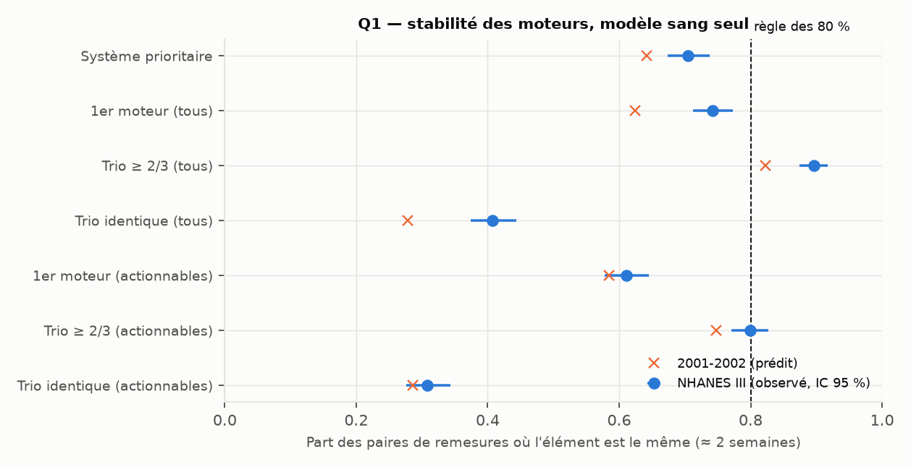

# Q1 — Changement significatif et stabilité des moteurs

Protocole pré-enregistré puis amendé (`DECISIONS.md`, « Suivi, Q1 et Q2 » et son amendement) ;
calage sur 2001-2002 (n = 388), test sur NHANES III (n = 781). Code : `src/aging_clock/suivi.py`.
Données : `Q1_Q2_predictions.json`, `Q1_Q2_nhanes3.json`, `Q1_paires_*.csv`.

> **Borne basse.** Les remesures ont lieu à environ 2 semaines, et en NHANES III à la même heure,
> avec le même protocole. Entre deux bilans à 6 mois, sans contrôle de l'heure ni du jeûne, les
> changements « sans effet réel » seront plus fréquents que ceux-ci.

## Seuils de changement significatif (modèle sang seul)

| Score | Prédit (2001-02) | NHANES III : P95 [IC 95 %] | Gaussien | Médiane de \|d\| | Compatible |
|---|---|---|---|---|---|
| Global | 5,99 | **7,14** [6,47 ; 7,54] | 6,82 | 2,02 | non (plus bruité) |
| Cardiovasculaire (lipides) | 2,69 | 2,27 [2,12 ; 2,53] | 2,20 | 0,65 | non (moins bruité) |
| Métabolique (glycémie, HbA1c) | 0,93 | 1,11 [0,95 ; 1,23] | 1,16 | 0,29 | non |
| Rénal | 4,43 | 5,88 [5,39 ; 6,31] | 5,63 | 1,44 | non (ACR) |
| Hépatique | 4,95 | 5,19 [4,74 ; 5,60] | 4,93 | 1,47 | oui |
| Inflammatoire | 4,49 | 4,79 [4,43 ; 5,52] | 4,68 | 1,33 | oui |

Modèle complet, partie biologique : global 6,20 [5,82 ; 6,63] (prédit 5,29). Les seuils des
systèmes cardiovasculaire et métabolique « sang seul » sont petits en années, parce que ces
systèmes varient peu entre personnes (étape 0). Ils ne disent presque rien de plus que l'âge.

## Stabilité des moteurs (modèle sang seul)

| Indicateur | Prédit | NHANES III [IC 95 %] | Compatible | Règle des 80 % |
|---|---|---|---|---|
| Même système prioritaire (écart standardisé) | 64,2 % | 70,4 % [67,3 ; 73,8] | non | **non affichable** |
| Même premier moteur (tous) | 62,4 % | 74,3 % [71,2 ; 77,3] | non | non affichable |
| Même trio (tous) | 27,8 % | 40,7 % [37,4 ; 44,3] | non | non affichable |
| Trio largement stable, ≥ 2/3 (tous) | 82,2 % | **89,6 %** [87,4 ; 91,7] | non | **affichable avec confiance** |
| Même premier moteur actionnable | 58,5 % | 61,1 % [57,7 ; 64,5] | oui | non affichable |
| Même trio actionnable | 28,6 % | 30,9 % [27,7 ; 34,3] | oui | non affichable |
| Trio actionnable largement stable | 74,7 % | 79,9 % [77,1 ; 82,7] | non | non affichable (juste sous 80 %) |

Modèle complet (partie biologique) : système prioritaire 76,4 % ; trio actionnable largement
stable 80,3 % [77,5 ; 83,1], **affichable** mais pas « avec confiance ».

**Par tertile d'écart global au premier bilan** (sang seul) : la stabilité augmente avec l'écart.
- Système prioritaire : 63 %, 71 %, 77 %.
- Trio actionnable largement stable : 77 %, 78 %, 84 %.

Les personnes les plus « vieilles » ont des moteurs plus nets.

**Nombre de moteurs** : 3 pour toutes les personnes de NHANES III ; 3 moteurs actionnables pour
647 sur 781, moins de 3 pour 134, aucun pour 12.

## Lecture (interprétation)

- **Le classement des systèmes n'est pas stable** : une fois sur trois, le système affiché
  « prioritaire » change entre deux prises de sang à deux semaines, sans aucun changement de santé.
- **Le premier moteur non plus** : une fois sur quatre (tous) ou presque deux sur cinq
  (actionnables), il change.
- **Ce qui est stable**, c'est un **groupe** de moteurs (au moins 2 sur 3 en commun), surtout
  sans restriction aux actionnables. Le trio actionnable est à la limite de la règle.
- NHANES III est plus stable que prévu pour les moteurs « tous », probablement en partie parce que
  la CRP y est censurée (58 % à 2,1 mg/L), ce qui fige un moteur fréquent. Les moteurs
  actionnables, eux, ont été bien prédits.
