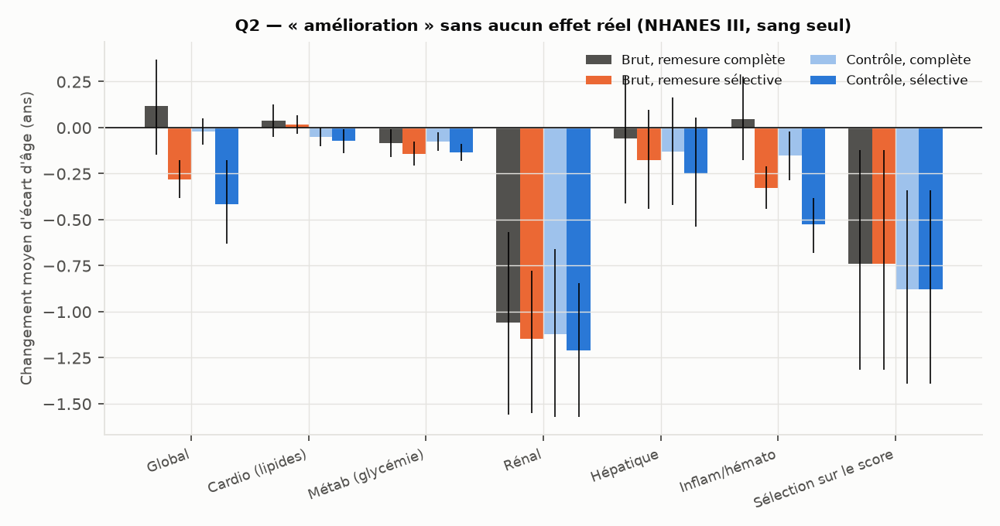

# Q2 — Régression vers la moyenne et remesure des seuls marqueurs anormaux

Protocole pré-enregistré puis amendé (`DECISIONS.md`) ; calage 2001-2002, test NHANES III
(n = 781). Modèle principal « sang seul ». Code : `src/aging_clock/suivi.py`.

> **Borne basse.** Les remesures ont lieu à environ 2 semaines, sans aucune intervention : tout
> « changement » ci-dessous est du bruit, de la régression vers la moyenne ou un décalage entre
> examens. À 6 mois, ces effets seront au moins aussi grands.

## Méthode recommandée : l'analyse avec groupe contrôle

Pour juger l'effet d'un protocole (par exemple « remesurer les anomalies après conseils »), on
compare le changement du groupe sélectionné à celui de **toute la population remesurée**. On retire
ainsi le décalage systématique entre examens, et il reste la part due à la sélection elle-même.

## Résultats NHANES III (sang seul), en années d'écart d'âge

Personnes ayant au moins un marqueur anormal au premier bilan, sauf la dernière ligne :

| Groupe | n | Brut, complète | Brut, sélective | **Contrôle, complète** | **Contrôle, sélective** |
|---|---|---|---|---|---|
| Global | 724 | +0,12 [−0,15 ; +0,37] | −0,28 [−0,38 ; −0,17] | −0,02 [−0,09 ; +0,05] | **−0,42** [−0,63 ; −0,18] |
| Cardio (lipides) | 575 | +0,04 | +0,02 | −0,05 [−0,10 ; −0,00] | −0,07 [−0,14 ; −0,01] |
| Métab (glycémie) | 337 | −0,08 | −0,14 | −0,08 [−0,13 ; −0,03] | −0,13 [−0,18 ; −0,09] |
| Rénal | 131 | −1,06 [−1,56 ; −0,57] | **−1,15** [−1,55 ; −0,78] | −1,12 [−1,57 ; −0,66] | −1,21 [−1,57 ; −0,84] |
| Hépatique | 206 | −0,06 | −0,18 | −0,13 [−0,42 ; +0,16] | −0,25 [−0,54 ; +0,05] |
| Inflam / hémato | 472 | +0,05 | −0,33 | −0,15 [−0,28 ; −0,02] | **−0,53** [−0,68 ; −0,38] |
| Sélection sur le score (20 % les plus « vieux ») | 157 | −0,74 [−1,32 ; −0,12] | — | **−0,88** [−1,39 ; −0,34] | — |

**Normalisation spontanée** au second examen, parmi les marqueurs anormaux au premier :
albumine 52 %, ALAT 46 %, ASAT 42 %, leucocytes 36 %, ACR 30 %, glucose 28 %, CRP 27 %,
plaquettes 28 %, lymphocytes 25 %, HbA1c 20 %, HDL 19 %, TG 15 %, cholestérol 12 %, GGT 12 %
(`Q2_marqueurs_nh3_sang.csv`).

## Règles pré-enregistrées

- **Remesure sélective trompeuse** (amélioration > 25 % du seuil) : **oui pour le rénal**
  (1,15 an > 1,11) ; non pour le global (0,28 < 1,50) ni pour les autres systèmes.
- **Correction marqueur par marqueur** (principale) : **non validée**.
  - Remesure complète : le global n'est pas dans la marge d'équivalence (+0,73 [+0,48 ; +0,98]
    pour une marge de ±0,60).
  - Remesure sélective : le global l'est (+0,08 [−0,03 ; +0,18]), mais seulement 3 systèmes sur 5
    (le rénal et l'hépatique échouent).
  - La correction **surcorrige** : elle attend une régression vers la moyenne plus forte que celle
    observée.
- **Correction au niveau du score** (secondaire, ajoutée au calage) : **non validée**
  (global +0,61 [+0,37 ; +0,86]).
- **Compatibilité avec 2001-2002** : bonne pour les changements bruts de la plupart des groupes
  (global, métab, rénal, inflammatoire, sélection sur le score). Elle ne l'est pas pour le contrôle
  du cardio, du métab et du rénal (effets différents en NHANES III), ni pour l'hépatique brut et en contrôle sélectif.
  Détail : `Q1_Q2_nhanes3.json`.

Sensibilités : seuils par centiles du développement et moyenne interne. Mêmes conclusions : la
remesure sélective du global donne −0,40 an brut ; la correction reste positive pour le global.

## Lecture (interprétation)

1. **Ne remesurer que les anomalies fabrique une amélioration** : environ 0,4 an sur le score
   global et 0,5 an sur l'inflammatoire, une fois le décalage entre examens retiré, et cela sans
   aucun effet réel.
2. **Le rénal « s'améliore » d'environ 1 an chez les personnes à ACR anormale**, que la remesure
   soit complète ou sélective. Une ACR anormale sur un seul échantillon revient souvent vers la
   normale (30 % de normalisation). C'est le cas d'école de la régression vers la moyenne.
3. **Sélectionner sur le score** (les 20 % les plus « vieux ») donne près d'un an d'amélioration
   apparente.
4. **Aucune correction statistique simple n'a passé le test.** La seule méthode robuste pour
   affirmer une amélioration est la comparaison à un groupe contrôle, ou au minimum la remesure
   complète du panel avec soustraction du changement moyen de la population.
